# Orbitium · Diseño de la cápsula

**Manual técnico del diseño físico · SATLINK 2026**  
Instituto Tecnológico de Pabellón de Arteaga · TecNM  
12 de noviembre de 2026

Documentación de la estructura de poliestireno extruido, los soportes de aterrizaje y el sistema de recuperación. Incluye fotografías del prototipo, ilustraciones de las piezas, medidas aproximadas y criterios de revisión.

<p align="center">
  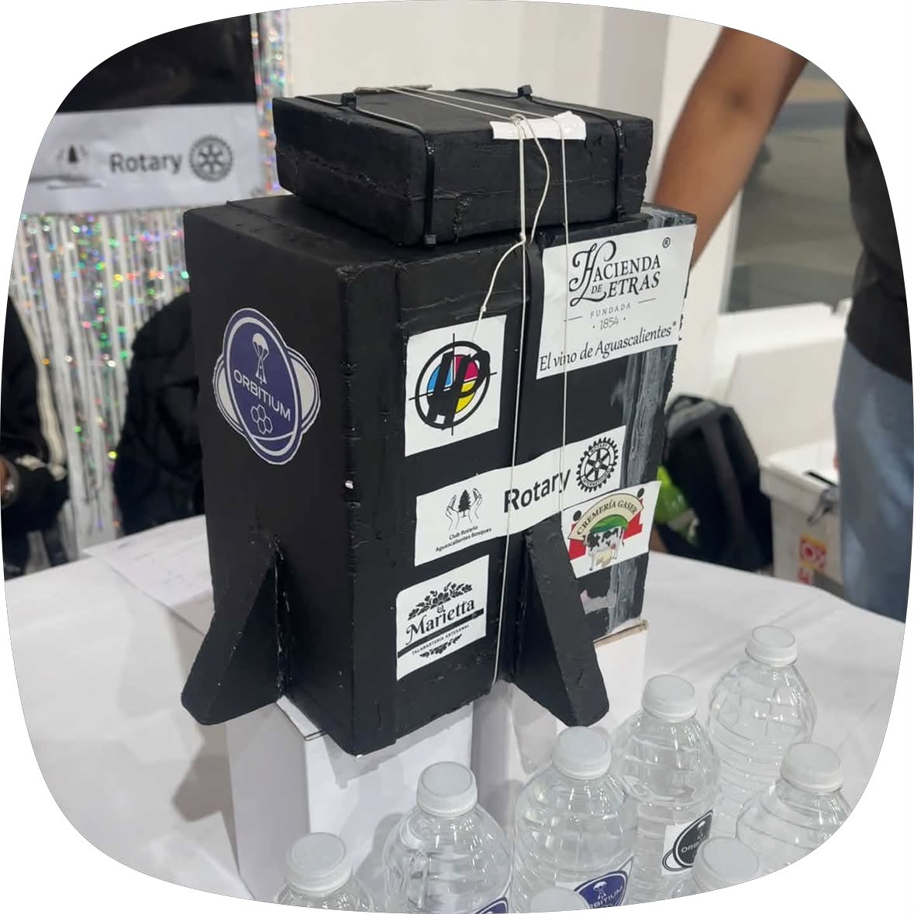
</p>

[Descargar manual técnico en Word](Manual_Tecnico_Diseno_Capsula_Orbitium.docx)

## El diseño de un vistazo

| Conjunto | Configuración |
| --- | --- |
| Cuerpo | Cuatro caras de XPS y cierres superior e inferior; uniones con RTV gris. |
| Aterrizaje | Cuatro soportes triangulares, uno centrado por cara. |
| Cubierta | Pieza de XPS de aproximadamente 15 × 15 × 5 cm, con hueco inferior de unos 3 cm; sin tapa independiente. |
| Recuperación | Paracaídas unido al arnés; tejido y líneas libres para desplegarse. |
| Liberación | Nicromo expuesto que corta el hilo de retención. |

### Vistas ilustradas

| Frontal | Lateral | Trasera |
| :---: | :---: | :---: |
| [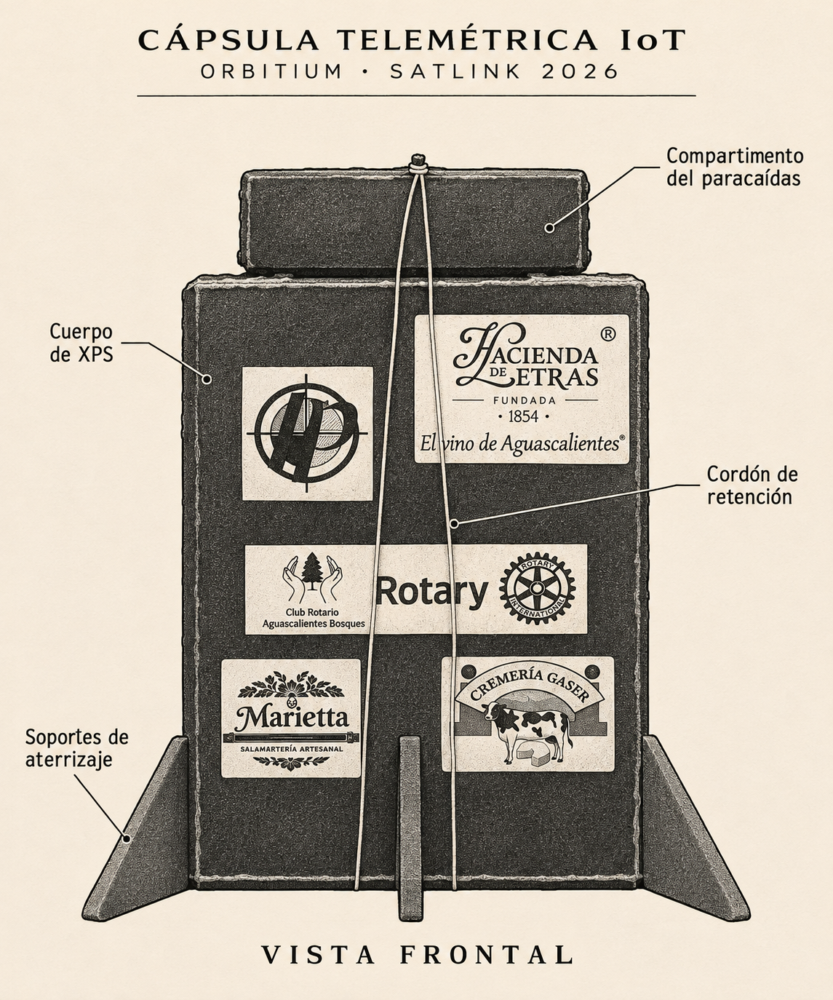](imagenes/frontal.png) | [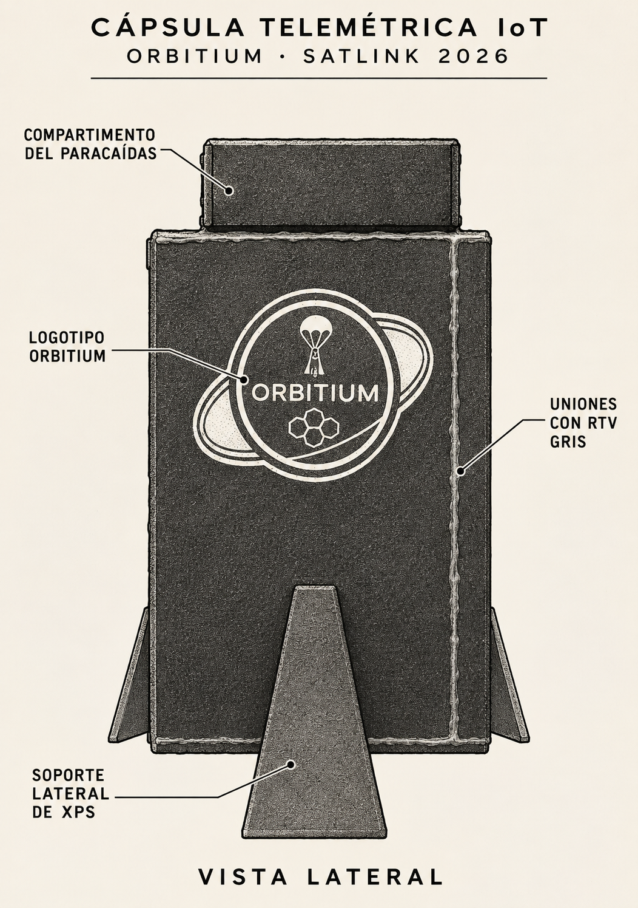](imagenes/lateral.png) | [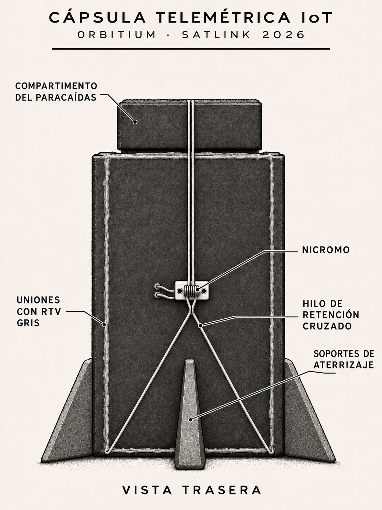](imagenes/trasera.png) |

> **Medidas aproximadas:** las cotas de los paneles corresponden a piezas individuales. El diámetro de 20–25 cm del paracaídas es una estimación pendiente de medición directa. Las ilustraciones explican la disposición del diseño y no son planos a escala.

## Contenido

- [Orbitium · Diseño de la cápsula](#orbitium--diseño-de-la-cápsula)
  - [El diseño de un vistazo](#el-diseño-de-un-vistazo)
    - [Vistas ilustradas](#vistas-ilustradas)
  - [Contenido](#contenido)
  - [1. Propósito](#1-propósito)
    - [Cómo consultar las medidas](#cómo-consultar-las-medidas)
  - [2. Materiales y dimensiones](#2-materiales-y-dimensiones)
    - [Relación entre paneles y dimensiones exteriores](#relación-entre-paneles-y-dimensiones-exteriores)
  - [3. Paneles del cuerpo principal](#3-paneles-del-cuerpo-principal)
  - [4. Ensamblaje de la estructura](#4-ensamblaje-de-la-estructura)
  - [5. Soportes de aterrizaje](#5-soportes-de-aterrizaje)
  - [6. Cubierta de despliegue](#6-cubierta-de-despliegue)
    - [Ajuste y liberación](#ajuste-y-liberación)
  - [7. Paracaídas y arnés](#7-paracaídas-y-arnés)
  - [8. Retención y corte por nicromo](#8-retención-y-corte-por-nicromo)
  - [9. Distribución interior](#9-distribución-interior)
  - [10. Vistas del prototipo](#10-vistas-del-prototipo)
  - [11. Secuencia de integración](#11-secuencia-de-integración)
    - [Comprobación mecánica de la liberación](#comprobación-mecánica-de-la-liberación)
  - [12. Verificación y evidencias](#12-verificación-y-evidencias)
    - [Alcance de las pruebas registradas](#alcance-de-las-pruebas-registradas)
    - [Registro de inspección](#registro-de-inspección)
  - [13. Conservación y referencias](#13-conservación-y-referencias)
    - [Inspección después de una prueba](#inspección-después-de-una-prueba)
    - [Datos por completar en la ficha del prototipo](#datos-por-completar-en-la-ficha-del-prototipo)
    - [Glosario](#glosario)
    - [Fuentes del diseño](#fuentes-del-diseño)
    - [Archivos de consulta](#archivos-de-consulta)
  - [Organización de los archivos](#organización-de-los-archivos)

---

## 1. Propósito

La cápsula Orbitium integra una envolvente ligera de poliestireno extruido (XPS), cuatro soportes de aterrizaje y una cubierta superior que protege el paracaídas preparado para desplegarse. El arnés mantiene unido el paracaídas a la cápsula.

Este manual describe el diseño mecánico, las piezas, el ensamblaje y las comprobaciones físicas.

### Cómo consultar las medidas

Las dimensiones de los paneles proceden del listado de corte de la bitácora 7. Las medidas de la cubierta y la estimación del diámetro del paracaídas corresponden a la descripción del diseño físico. Las cotas se expresan como aproximadas y deben comprobarse sobre las piezas antes de fabricar repuestos.


## 2. Materiales y dimensiones

El cuerpo principal se ensambla con paneles de XPS unidos mediante silicón RTV gris. El material también se utiliza en los soportes y en la cubierta del paracaídas. El acabado exterior negro y los identificadores se observan en las fotografías del prototipo final.

| Pieza o elemento | Cantidad | Medida o característica |
| --- | --- | --- |
| Panel frontal y panel trasero | 2 | ≈ 20 × 20 cm cada uno |
| Panel lateral izquierdo y derecho | 2 | ≈ 15 × 20 cm cada uno |
| Cierre superior e inferior del cuerpo | 2 | ≈ 20 × 15 cm cada uno |
| Soporte de aterrizaje de XPS | 4 | Forma triangular; uno por cara, centrado |
| Cubierta de despliegue de XPS | 1 | ≈ 15 × 15 cm; altura ≈ 5 cm |
| Hueco central de la cubierta | 1 | Profundidad ≈ 3 cm; abierto hacia el paracaídas |
| Paracaídas con líneas | 1 | Diámetro desplegado estimado: 20–25 cm |
| Arnés, anillo y elementos de sujeción | Conjunto | Unión mecánica del paracaídas con la cápsula |
| RTV gris | Según uniones | Adhesivo de paneles y soportes |
| Nicromo, terminal y cableado | Conjunto | Mini resorte expuesto y control dentro de la cápsula |

### Relación entre paneles y dimensiones exteriores

Las medidas de corte de una cara no equivalen por sí solas al tamaño exterior del conjunto. El espesor del XPS, la forma de solapar las uniones, los soportes y la cubierta modifican las dimensiones ensambladas. La altura de 23 cm indicada en la memoria no sustituye las cotas individuales del listado de corte.

El espesor del XPS, las dimensiones exactas de los soportes y la anchura del hueco central deben medirse en el prototipo. No se obtienen escalando las ilustraciones.

> **Cotas de piezas**
> **20 × 20 cm y 15 × 20 cm son tamaños aproximados de paneles.** La altura y la huella exterior del tren completo se registran por separado.

## 3. Paneles del cuerpo principal

Las cuatro caras verticales forman la envolvente. Los nombres frontal, trasera y lateral identifican la posición de cada panel; la expresión tapa se conserva en las láminas de las piezas. Son paneles sin los soportes ni la cubierta de despliegue.

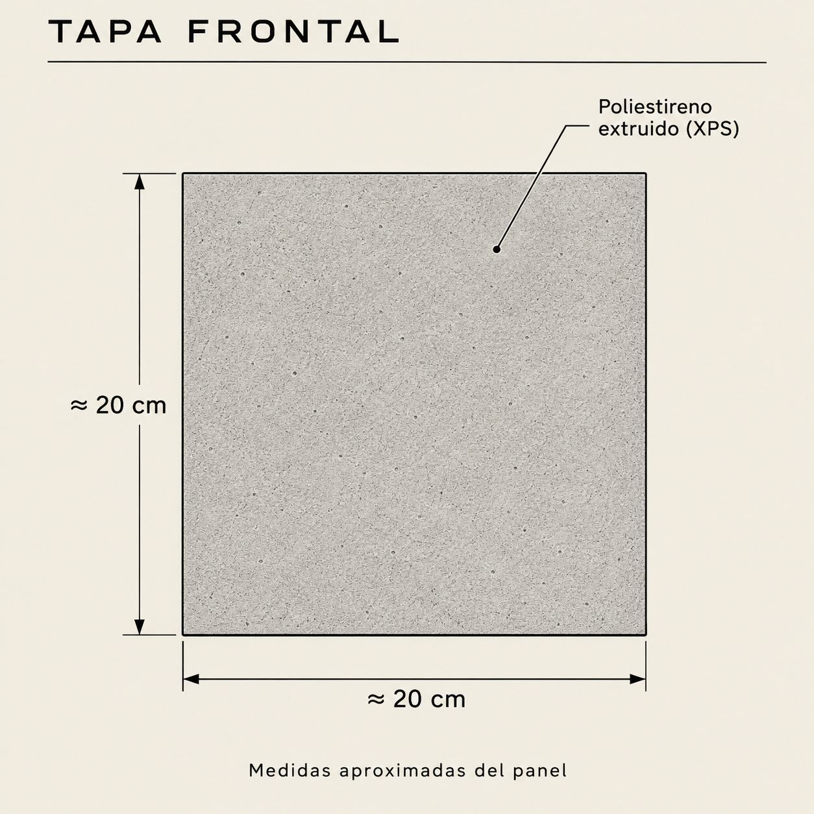

*Figura 1. Panel frontal de XPS. Ilustración; ≈ 20 × 20 cm.*

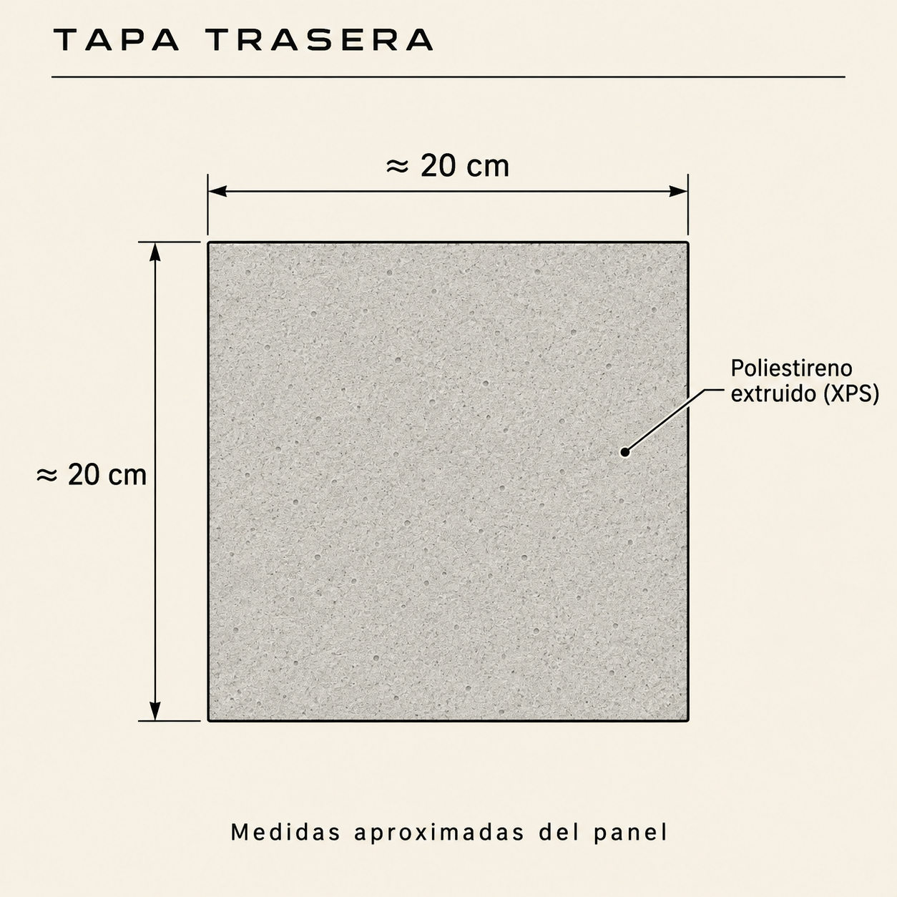

*Figura 2. Panel trasero de XPS. Ilustración; ≈ 20 × 20 cm.*

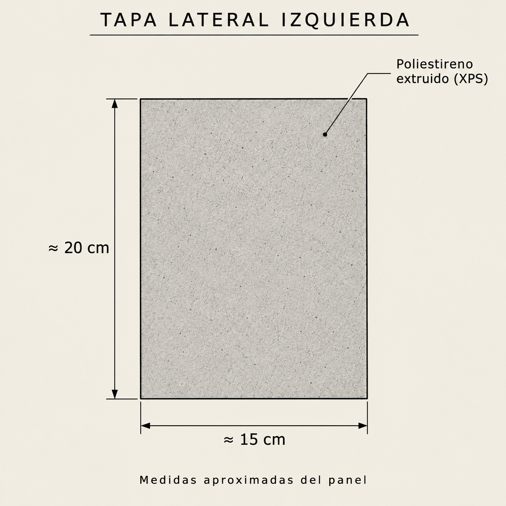

*Figura 3. Panel lateral izquierdo. Ilustración; ≈ 15 × 20 cm.*

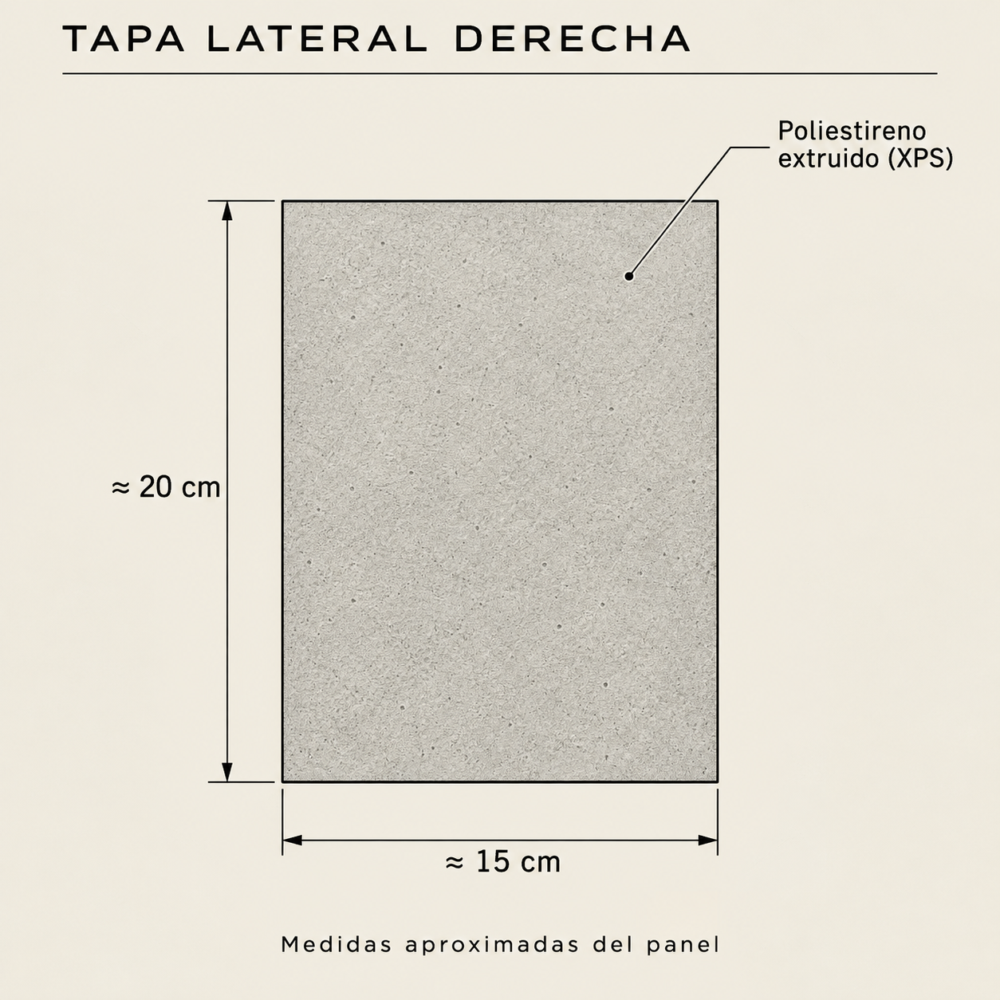

*Figura 4. Panel lateral derecho. Ilustración; ≈ 15 × 20 cm.*

Además de las cuatro caras se requieren un cierre superior y uno inferior del cuerpo, de aproximadamente 20 × 15 cm cada uno. El cierre superior del cuerpo sirve de apoyo al conjunto del paracaídas y es diferente de la cubierta que se libera.

## 4. Ensamblaje de la estructura

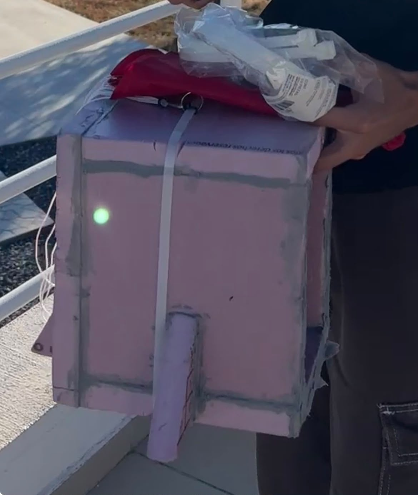

*Figura 5. Fotografía de la estructura antes del acabado exterior.*

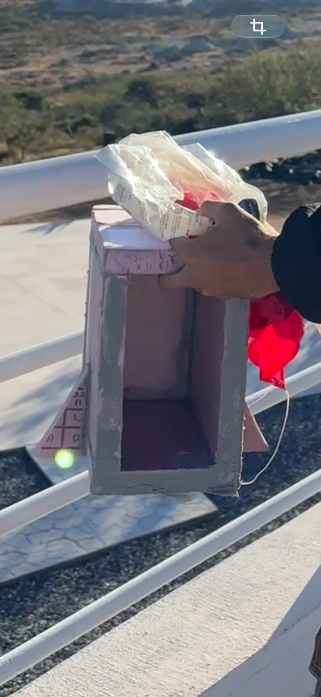

*Figura 6. Fotografía de la cara abierta y el espacio interior.*

1. Identificar, medir y marcar las cuatro caras, el cierre superior y la base. Presentar las piezas sin adhesivo para comprobar su ajuste.
2. Unir los paneles con RTV gris, manteniendo la escuadra y evitando que los cordones de adhesivo invadan las zonas de alojamiento.
3. Dejar temporalmente una cara accesible para distribuir y sujetar los componentes internos. Comprobar el ajuste del panel de acceso antes del cierre.
4. Respetar el curado del producto utilizado. La bitácora 7 registra una espera aproximada de 24 horas; confirmar el tiempo aplicable en el envase.
5. Revisar juntas, bordes y continuidad de la envolvente antes de colocar soportes y acabado exterior.

## 5. Soportes de aterrizaje

Se utilizan cuatro piezas triangulares de XPS, una centrada en la zona inferior de cada cara. Su función en el diseño es ampliar el apoyo del conjunto y recibir parte del contacto durante el aterrizaje. Las esquinas quedan libres de soportes.

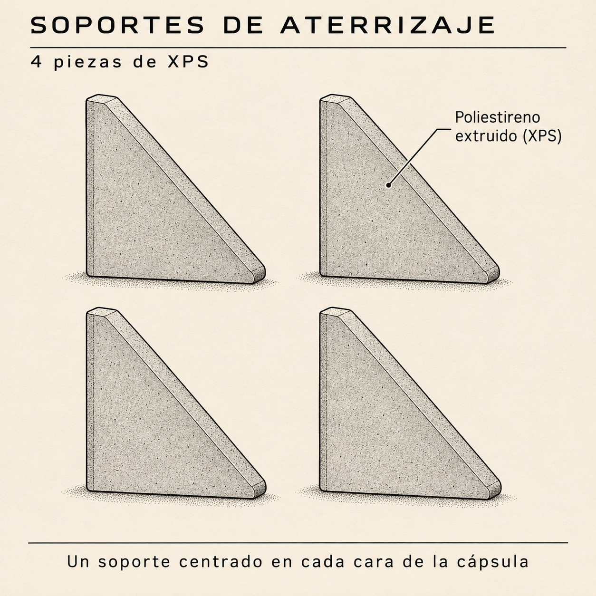

*Figura 7. Despiece ilustrado de los cuatro soportes.*

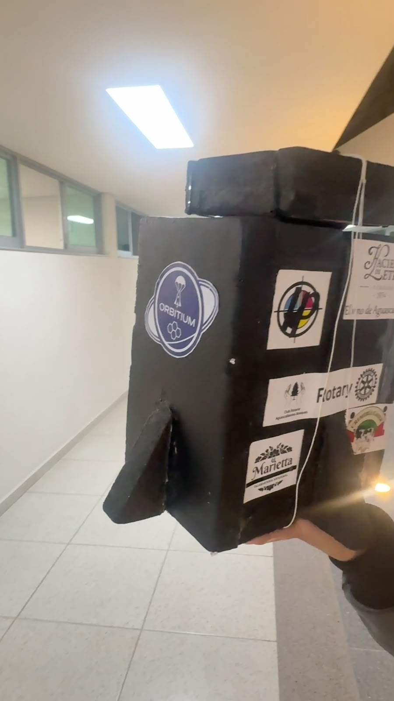

*Figura 8. Fotografía del soporte centrado en una cara lateral.*

- El borde de unión del soporte se fija a la cara correspondiente; la parte saliente se orienta hacia afuera.
- El soporte frontal y el trasero quedan sobre el eje central de sus respectivas caras. Los dos laterales se colocan con el mismo criterio.
- Comprobar la alineación de las cuatro zonas de apoyo sobre una superficie plana y la firmeza de cada unión.
- Reponer una pieza dañada a partir de la geometría medida en el soporte original. La lámina de despiece no fija dimensiones de corte.

En las elevaciones frontal y trasera, el soporte de esa cara se observa estrecho en el centro, mientras los soportes de los costados se aprecian de perfil. Esta proyección no implica fijación en las esquinas.

## 6. Cubierta de despliegue

La pieza superior es una cubierta de XPS de aproximadamente 15 × 15 cm y 5 cm de altura. Tiene un hueco central de unos 3 cm de profundidad orientado hacia el paracaídas. Se coloca sobre el paracaídas ya unido a la cápsula por el arnés.

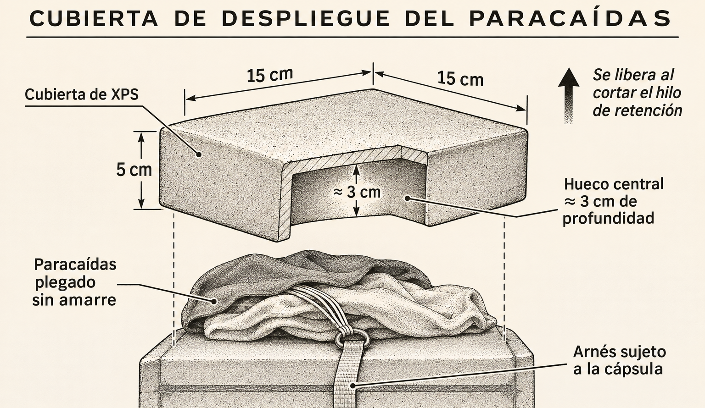

*Figura 9. Ilustración en despiece de la cubierta y el paracaídas conectado al arnés. La separación vertical y el recorte muestran el hueco.*

### Ajuste y liberación

El hueco proporciona espacio al tejido preparado para el despliegue. El hilo de retención mantiene la cubierta en posición durante la preparación y se corta mediante el nicromo para permitir que el paracaídas quede libre. La ilustración representa la cubierta separada para explicar su relación con el tejido y el arnés.

- Comprobar que el tejido y las líneas no queden atrapados entre los bordes de la cubierta y la superficie superior del cuerpo.
- Preparar el paracaídas sin enrollar ni amarrar sus líneas alrededor del tejido.
- Verificar que, al retirar la retención, la cubierta pueda separarse sin pegarse al arnés ni arrastrar conexiones.

## 7. Paracaídas y arnés

El paracaídas es pequeño; su diámetro desplegado se estima entre 20 y 25 cm. Este intervalo es una referencia visual aportada para el diseño.

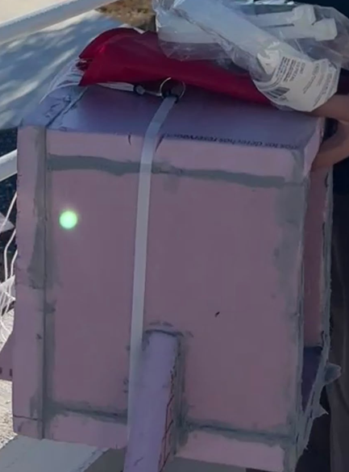

*Figura 10. Fotografía del paracaídas y la unión mediante anillo al arnés, antes de colocar la cubierta.*

El arnés está colocado en la cápsula y constituye la unión de carga con el paracaídas. El hilo de retención cumple otra función: mantener la cubierta en posición hasta el corte. Cortar la retención debe liberar el despliegue manteniendo la unión entre el paracaídas y el cuerpo.

1. Comprobar el anclaje del arnés y la unión del anillo con las líneas del paracaídas.
2. Extender y ordenar las líneas para comprobar que no se crucen de forma que impidan el despliegue.
3. Acomodar el tejido sobre la zona superior sin formar un paquete atado con sus propias líneas.
4. Colocar la cubierta dejando libres la unión al arnés y el recorrido de la retención.

## 8. Retención y corte por nicromo


*Figura 11. Vista trasera ilustrada con la disposición confirmada del mecanismo.*

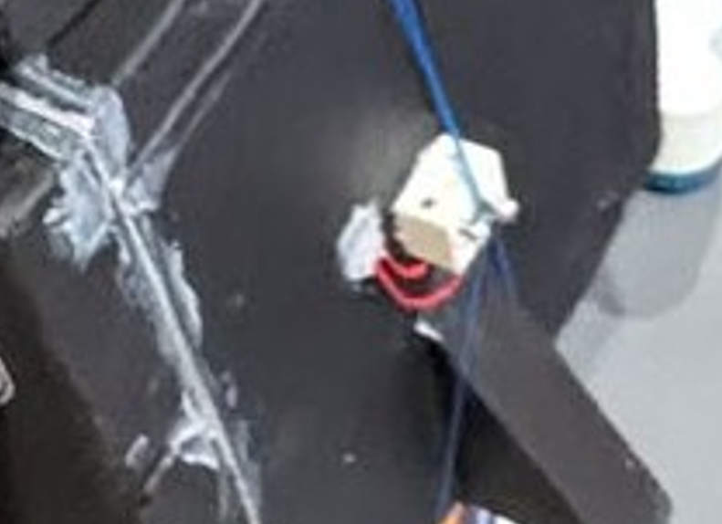

*Figura 12. Detalle fotográfico del terminal, nicromo y conexiones locales.*

El elemento de corte es un mini resorte de nicromo expuesto. El hilo de retención se coloca en contacto con este elemento; al energizarlo, el calentamiento produce el corte que libera la cubierta. La placa de control y la mayor parte del cableado permanecen dentro de la cápsula.

Junto al terminal se observan tramos cortos de cable a su lado izquierdo. Los dos ramales del hilo van juntos desde la parte superior, se cruzan por debajo de la zona de corte y se abren hacia la zona inferior. El arnés permanece unido a la cápsula después de liberar la retención.

Comprobar visualmente el contacto entre hilo y nicromo, la sujeción del terminal y la separación del elemento caliente respecto del XPS y del tejido. El hilo cortado debe sustituirse antes de una nueva preparación.

## 9. Distribución interior

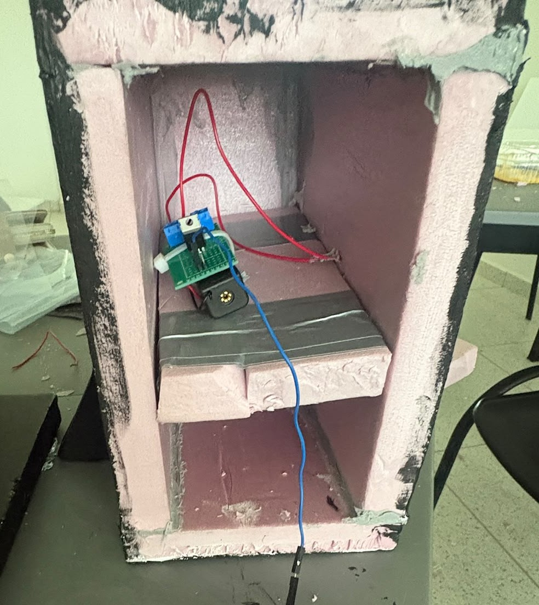

*Figura 13. Fotografía del circuito de corte y los pasos de cable en el interior.*


*Figura 14. Fotografía del volumen interior y acceso para integración.*

El espacio interno aloja la electrónica, la alimentación y el control del mecanismo de corte. Las fotografías muestran un soporte interior de XPS y cableado dirigido hacia la cara del mecanismo. La cara accesible facilita acomodar y revisar los componentes antes del cierre.

- Sujetar la placa, la alimentación y los conductores para que no golpeen las paredes ni tiren del terminal exterior.
- Dejar accesibles los puntos necesarios para conexión e inspección sin comprimir el cableado al cerrar el panel.
- Separar el recorrido de las líneas del paracaídas y del arnés del cableado eléctrico.
- Comprobar que los pasos por el XPS no corten el aislamiento ni reciban la tracción de la cubierta.

La memoria menciona una Heltec WiFi LoRa 32 V3, sensores y una placa de montaje. Su presencia se considera únicamente para reservar espacio y sujeción.

## 10. Vistas del prototipo

Las fotografías conservan el aspecto construido; las ilustraciones permiten identificar piezas y recorridos.

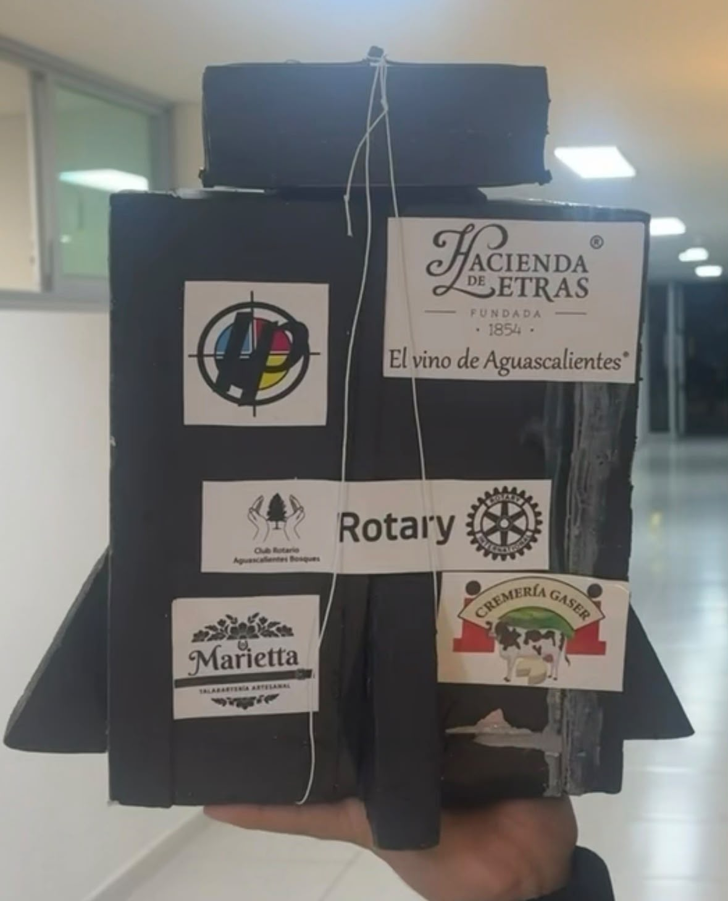

*Figura 15. Vista frontal real, con acabado e identificadores.*


*Figura 16. Vista frontal ilustrada.*


*Figura 17. Vista lateral real con el logotipo Orbitium.*


*Figura 18. Vista lateral ilustrada.*

## 11. Secuencia de integración

La preparación se realiza por conjuntos para comprobar primero la estructura y después la liberación. La cubierta puede retirarse para revisar el paracaídas sin desmontar el arnés del cuerpo.

| Etapa | Trabajo | Resultado a comprobar |
| --- | --- | --- |
| 1 Estructura | Presentar y unir caras, base y cierre superior. | Ajuste estable, acceso interior y juntas curadas. |
| 2 Soportes | Fijar una pieza centrada por cada cara. | Cuatro apoyos firmes y sin desplazamiento. |
| 3 Interior | Sujetar componentes y guiar los cables. | Panel de acceso cierra sin presionar conexiones. |
| 4 Arnés | Instalar y revisar la unión con el paracaídas. | La unión de carga permanece al retirar la cubierta. |
| 5 Paracaídas | Ordenar líneas y acomodar tejido libre. | Sin amarres alrededor del tejido ni líneas atrapadas. |
| 6 Cubierta | Asentar el hueco sobre el paracaídas. | Cobertura y separación libres de interferencias. |
| 7 Retención | Guiar hilo junto arriba y cruzado abajo; situarlo en el nicromo. | Contacto de corte y recorrido correctos. |
| 8 Revisión final | Pesar, medir y registrar la configuración completa. | Trazabilidad de masa, dimensiones y estado. |

### Comprobación mecánica de la liberación

Con la alimentación del corte desconectada, retirar manualmente la retención de prueba y comprobar que la cubierta y el tejido quedan libres mientras el arnés mantiene su unión. Esta revisión comprueba interferencias físicas; la activación eléctrica y el descenso del conjunto se evalúan en ensayos específicos.

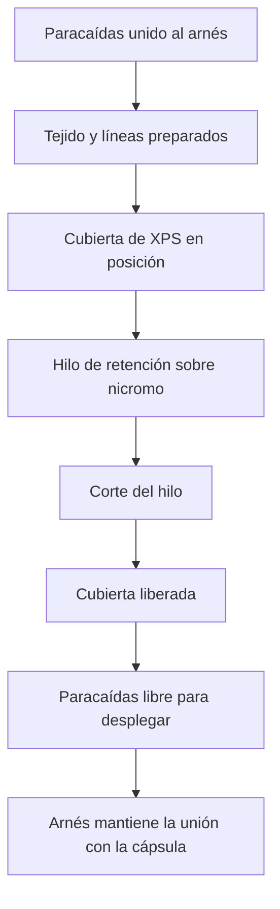

## 12. Verificación y evidencias

La aceptación del diseño exige comprobar la configuración completa que se utilizará. Un registro de otra etapa de construcción no determina automáticamente la masa o el comportamiento de la versión final.

| Elemento | Criterio de revisión |
| --- | --- |
| Paneles y juntas | Sin grietas abiertas, bordes sueltos ni uniones que cedan al manejo. |
| Apoyos | Cuatro soportes centrados, adheridos y con contacto estable. |
| Interior | Electrónica y alimentación sujetas; cierre sin cables prensados. |
| Arnés | Unión continua entre paracaídas y cápsula, independiente del hilo de retención. |
| Paracaídas y cubierta | Tejido sin amarre, líneas ordenadas y hueco sin interferencias. |
| Zona de corte | Nicromo expuesto, hilo en contacto y conexiones locales a la izquierda. |
| Masa y dimensiones | Medición del tren completo: cuerpo, electrónica, cubierta, arnés, paracaídas y cuerdas. |

### Alcance de las pruebas registradas

La bitácora 9 documenta lanzamientos de prueba del paracaídas y una prueba de frío con hielo. La memoria reporta 10 m de altura, 2.5 s de descenso y una prueba a −26 °C con hielo seco.

La fotografía de báscula muestra 740gr. Para contrastar la referencia de 750 gr del proyecto, pesar nuevamente el tren completo y consultar la convocatoria aplicable.

> **Registro de validación**
> Diámetro de paracaídas, masa final, dimensiones exteriores y resultados de ensayo deben verificarse para la configuración que se use. Las ilustraciones explican el diseño y no certifican el desempeño.

### Registro de inspección

- [ ] Medir espesor y paneles reales.
- [ ] Medir cuatro soportes y revisar sus uniones.
- [ ] Medir cubierta y hueco central.
- [ ] Medir diámetro del paracaídas extendido.
- [ ] Revisar arnés y líneas libres.
- [ ] Verificar recorrido de retención y contacto con nicromo.
- [ ] Registrar masa del tren completo.
- [ ] Registrar configuración y resultados de liberación.

## 13. Conservación y referencias

### Inspección después de una prueba

Retirar la cubierta e inspeccionar el XPS, las uniones, los soportes y el arnés. Revisar el terminal y las conexiones que atraviesan la pared. Sustituir el hilo consumido y cualquier elemento deformado, quemado o desprendido antes de preparar otro ensayo. Mantener el paracaídas limpio y seco, con las líneas libres para su revisión.

### Datos por completar en la ficha del prototipo

Registrar el espesor del XPS; las cotas de los cuatro soportes; la anchura y forma del hueco; el diámetro medido del paracaídas; el material y longitud de las líneas; las características del arnés; la masa y las dimensiones exteriores del conjunto. Vincular cada registro a una fecha y una fotografía de la configuración.

### Glosario

| Término | Uso en este diseño |
| --- | --- |
| XPS | Poliestireno extruido de paneles, soportes y cubierta. |
| RTV | Silicón utilizado en las uniones de la estructura. |
| Arnés | Sujeción que conecta mecánicamente la cápsula al paracaídas. |
| Retención | Hilo que mantiene la cubierta en posición hasta el corte. |
| Nicromo | Elemento resistivo en forma de mini resorte que calienta y corta la retención. |

### Fuentes del diseño


[4] MEMORIA TECNICA.pdf. Descripción general, estructura y pruebas reportadas, pp. 5–9.
### Archivos de consulta

- [Bitácora 7](referencias/Bitacora_Proyecto7.docx)
- [Bitácora 8](referencias/Bitacora_Proyecto8.docx)
- [Bitácora 9](referencias/Bitacora_Proyecto9.docx)
- [Memoria técnica](referencias/MEMORIA_TECNICA.pdf)

> **Relaciones del diseño**
> [3. Paneles del cuerpo principal](#3-paneles-del-cuerpo-principal) y [5. Soportes de aterrizaje](#5-soportes-de-aterrizaje) forman la estructura. [6. Cubierta de despliegue](#6-cubierta-de-despliegue), [7. Paracaídas y arnés](#7-paracaídas-y-arnés) y [8. Retención y corte por nicromo](#8-retención-y-corte-por-nicromo) forman el conjunto de liberación y recuperación.


## Organización de los archivos

```text
.
├── README.md
├── Manual_Tecnico_Diseno_Capsula_Orbitium.docx
├── imagenes/       Fotografías reales e ilustraciones utilizadas
└── referencias/    Tres bitácoras y memoria técnica de consulta
```

Las imágenes y referencias utilizan rutas relativas. Para conservar la visualización al subir o mover esta documentación, mantén `README.md` junto a las carpetas `imagenes` y `referencias`.
